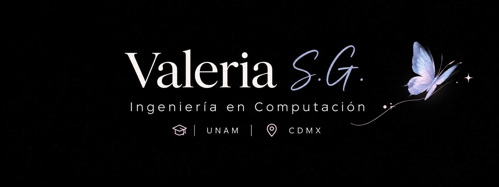

<!-- ✦ PROFILE BANNER ✦ -->

  

<h1 align="center">Hi there, I'm Valeria! 🦋</h1>

  <strong>Computer Engineering Graduate | UNAM</strong> 
  Mexico City, Mexico

  <em>Turning data into insights and ideas into practical solutions.</em>

---

## 👩🏻‍💻 About Me

I'm a Computer Engineering graduate from the National Autonomous University of Mexico (UNAM), interested in data analysis, database management, software development, and technology-driven solutions.

Throughout my academic projects, I've worked with SQL, relational databases, programming, electronics, and automation. I also enjoy organizing information, preparing technical documentation, and creating structured reports.

I'm an adaptable, organized, and analytical person who enjoys learning new technologies and solving problems.

- 📊 Interested in data analysis and information management.
- 🗄️ Experienced in academic SQL and MySQL projects.
- 🤖 Interested in electronics, Arduino, and automation.
- 📝 Passionate about technical documentation and reporting.
- 🌎 Interested in research and international collaboration.
- 🚀 Focused on continuous learning and professional growth.

## 🛠️ Technical Skills

### Databases & Data
- SQL
- MySQL
- Data querying, filtering, joins, grouping, and aggregation

### Programming & Web Development
- Python — developing my skills
- HTML
- CSS
- JavaScript

### Electronics & Automation
- Arduino
- Electronics projects
- Automation fundamentals

### Design & Documentation
- Autodesk Fusion 360
- Technical drawings
- Technical documentation and reports

## 📚 Currently Learning

- 📈 Power BI and data visualization
- 📊 R for data analysis
- 🐍 Python for data processing and analysis
- 🌐 Professional English communication

## 💻 Featured Projects

### 🗄️ Database Management & SQL
Academic projects involving relational databases, SQL queries, data filtering, joins, grouping, and information retrieval.

### 🤖 Arduino & Electronics
Electronic circuits and microcontroller projects involving programming, inputs, outputs, and automation.

### 🎮 Unity — 3D Virtual Tour
An interactive 3D environment featuring player controls, trigger-based interactions, multimedia elements, and user interface functionality.

### 📝 Technical Documentation
Engineering documentation, laboratory practices, technical manuals, and educational resources for mechatronics and automation projects.

> More projects, source code, and documentation will be added as I continue developing my portfolio.

## 🎯 Current Goals

- Strengthen my data analysis and programming skills.
- Build practical projects using SQL, Python, and Power BI.
- Improve my ability to communicate technical information.
- Participate in collaborative engineering and research projects.
- Continue growing as a Computer Engineering professional.

## 🤝 Let's Connect!

I'm interested in connecting with people working in data analysis, software development, engineering, and technology.

  
  <!-- Add your LinkedIn and professional email when ready -->

  <em>Thanks for visiting my profile! ✨</em>

